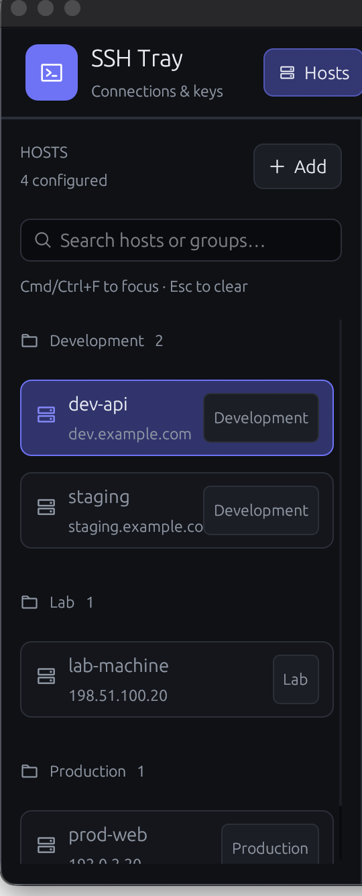

# SSH Tray

A native SSH menu-bar and management app written in Rust. Connect to saved hosts in one click, organize machines by network, and manage SSH hosts and keys without editing config files by hand.



*The screenshot contains only fictional hosts, `example.com` domains, and TEST-NET addresses. No real SSH data is included.*

## Features

- **One-click SSH** from the macOS menu bar or Linux system tray.
- **Host CRUD:** add, edit, and delete hosts through a native panel.
- **Network groups:** organize hosts as Office, LAN, Cloudflare, or any custom group.
- **Clean host list:** only the first alias from each `Host` block is displayed; other aliases still work in Terminal.
- **Safe editing:** preserves `ProxyJump`, `ProxyCommand`, `RemoteCommand`, `Control*`, comments, includes, and unrelated config blocks.
- **Key management:** generate, inspect, copy, import, update, and remove key pairs.
- **Secure installation:** copy a public key to a server with `ssh-copy-id`.
- **Fast navigation:** searchable sidebar with **Cmd/Ctrl+F** to focus and **Escape** to clear.
- **Manual refresh only:** no background host or network scanning.

## Supported platforms

| Platform | Architectures | Terminal support |
|---|---|---|
| macOS | Apple Silicon | Apple Terminal |
| Linux | x86_64, aarch64 | `x-terminal-emulator`, GNOME Terminal, KGX, Konsole, XFCE Terminal, Alacritty, Kitty, WezTerm, Foot, or XTerm |

Linux requires a graphical desktop and an AppIndicator-compatible system tray. `$TERMINAL` can select a supported terminal explicitly.

## Requirements

- Nix with flakes enabled for the reproducible development shell
- Rust 1.95 or newer when building without Nix
- OpenSSH tools: `ssh`, `ssh-keygen`, and `ssh-copy-id`
- An SSH config at `~/.ssh/config`

## Quick start

```sh
git clone git@github.com:Kmassidik/SSH-Tray.git
cd SSH-Tray
nix develop
cargo run
```

Click the tray icon and select a host. Choose **Open Panel** to manage hosts and keys, **Refresh** to reload the config manually, or **Quit** to exit.

Open the management panel directly during development:

```sh
cargo run -- --panel
```

## Build

### macOS app bundle

```sh
nix develop --command ./scripts/package-macos.sh
open "target/SSH Tray.app"
```

The bundle uses `LSUIElement`, so SSH Tray runs in the menu bar without a Dock icon. Local builds are unsigned; macOS may require approval under **System Settings → Privacy & Security**.

### Linux release binary

```sh
nix develop
cargo build --release
./target/release/ssh-tray
```

Open only the management panel:

```sh
./target/release/ssh-tray --panel
```

## SSH host configuration

SSH Tray reads standard OpenSSH aliases and options. For example:

```sshconfig
# ssh-tray:group Development
Host dev-api
    HostName dev.example.com
    User developer
    Port 22
    IdentityFile ~/.ssh/id_ed25519

Host staging
    HostName staging.example.com
    User developer
    Port 22

# ssh-tray:group Production
Host prod-web
    HostName 192.0.2.20
    User deploy
    Port 22
```

A `# ssh-tray:group <name>` comment applies to following hosts until the next group directive. An empty `# ssh-tray:group` returns subsequent hosts to the top level. SSH ignores these comments.

Wildcard and negated `Host` patterns are omitted from the interface. For a block such as `Host macstudio studio`, only `macstudio` appears in the app; both aliases remain usable with `ssh`, and both remain editable in the host form.

## Panel workflows

### Hosts

- **Connect:** open Terminal with `ssh <alias>`.
- **Copy SSH Command:** copy the exact connection command.
- **Add / Edit:** manage aliases, HostName, User, Port, IdentityFile, and group.
- **Delete:** confirm removal of the entire host block, including every alias in that block.
- **Install on Server:** select a public key and run `ssh-copy-id` for the selected host.

### SSH keys

| Action | Behavior |
|---|---|
| Copy Public Key | Copy only the `.pub` contents |
| Generate Key | Create Ed25519 keys through interactive `ssh-keygen` |
| Import Key | Import a private key and its sibling `.pub` without overwriting |
| Edit Public Comment | Change only the public-key comment; key data stays unchanged |
| Change Passphrase | Open interactive `ssh-keygen -p` in Terminal |
| Remove Key Pair | Delete private and public files after explicit confirmation |

Imported private keys use mode `0600`; public keys use `0644`.

## Security and privacy

- Private-key contents are never displayed in the panel.
- Passphrases and server authentication are entered only in Terminal.
- SSH Tray does not store credentials or embed a separate SSH client.
- Existing keys are never overwritten during generation or import.
- Config updates use a sibling temporary file and atomic rename while preserving permissions.
- Hosts and keys refresh only on launch or when you click **Refresh**.
- Documentation screenshots use disposable demo data, never your real SSH configuration.

## Development

Enter the Nix shell:

```sh
nix develop
```

Run checks:

```sh
cargo test
cargo-fmt -- --check
cargo-clippy clippy -- -D warnings
```

Or run them without entering the shell:

```sh
nix develop --command cargo test
nix develop --command cargo-fmt -- --check
nix develop --command cargo-clippy clippy -- -D warnings
```

## Project structure

```text
src/
  app.rs       Tray icon and menu events
  panel.rs     Native egui management panel
  config.rs    SSH config parsing and atomic host CRUD
  keys.rs      Public-key inventory and safe key-file operations
  terminal.rs  Secure macOS/Linux terminal commands
assets/
  tray-icon.rgba
  sidebar-demo.png
packaging/
  Info.plist
scripts/
  package-macos.sh
flake.nix      macOS and Linux development shells
```
